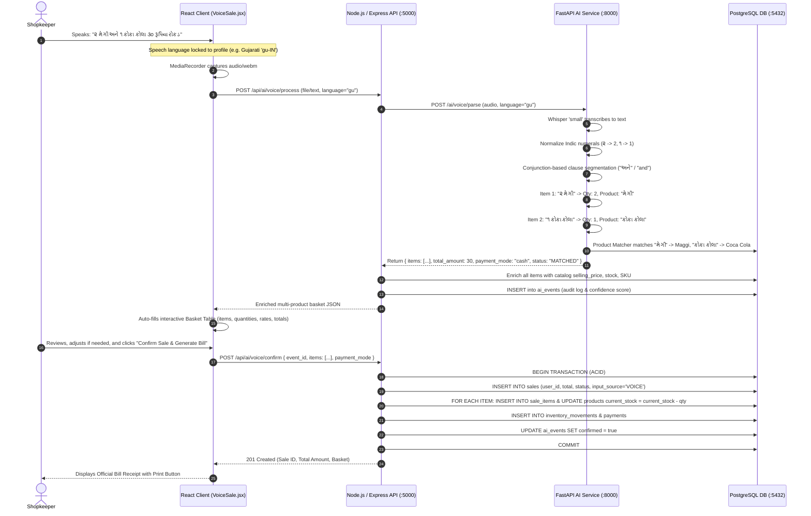

# Feature 01: Multilingual Voice Sales & Automated Bill Generation
## Technical Architecture & Implementation Specification

---

## 1. Problem & Business Objective
Small retail and grocery (Kirana) store owners operate in fast-paced counter environments where barcode scanning or typing on a keyboard for every small transaction is slow and disruptive. 

Furthermore, Indian retail is fundamentally **multilingual** and **basket-oriented**:
1. **Multilingual Speech**: Shopkeepers speak in their native regional tongue — **English (`en`)**, **Hindi (`hi`)**, **Marathi (`mr`)**, or **Gujarati (`gu`)**.
2. **Language Lock Requirement**: The speech recognition and NLP model must strictly follow the preferred language chosen during store registration or in settings. No manual language toggle is allowed on the sales screen.
3. **Multi-Product Basket Voice Recognition**: Customers rarely buy just one item. A customer typically asks for *"2 Maggi and 1 Coke"* or in Gujarati *"૨ મેગી અને ૧ કોકા કોલા ૩૦ રૂપિયા રોકડ"*. The AI must segment and recognize multiple items in a single spoken phrase without hallucinations.
4. **Instant Bill Generation**: Once confirmed, an official bill/receipt must be generated immediately with itemized lines, prices, totals, and print capabilities.

---

## 2. System Architecture & Component Flow



---

## 3. Data Models & Database Schemas

### A. Sales Header (`sales`)
```sql
CREATE TABLE sales (
    id SERIAL PRIMARY KEY,
    user_id INTEGER REFERENCES users(id) ON DELETE CASCADE,
    customer_id INTEGER REFERENCES customers(id) ON DELETE SET NULL,
    sale_date TIMESTAMP WITHOUT TIME ZONE DEFAULT CURRENT_TIMESTAMP,
    total_amount NUMERIC(12,2) NOT NULL,
    payment_status VARCHAR(20) DEFAULT 'PAID', -- 'PAID', 'PARTIAL', 'CREDIT'
    input_source VARCHAR(20) DEFAULT 'VOICE',  -- 'VOICE', 'MANUAL', 'INVOICE'
    created_at TIMESTAMP WITHOUT TIME ZONE DEFAULT CURRENT_TIMESTAMP
);
```

### B. Sale Line Items (`sale_items`)
```sql
CREATE TABLE sale_items (
    id SERIAL PRIMARY KEY,
    sale_id INTEGER REFERENCES sales(id) ON DELETE CASCADE,
    product_id INTEGER REFERENCES products(id) ON DELETE RESTRICT,
    quantity INTEGER NOT NULL,
    cost_price NUMERIC(10,2) NOT NULL,
    selling_price NUMERIC(10,2) NOT NULL,
    total_amount NUMERIC(12,2) NOT NULL,
    profit NUMERIC(12,2) NOT NULL
);
```

### C. AI Audit Trail (`ai_events`)
```sql
CREATE TABLE ai_events (
    id SERIAL PRIMARY KEY,
    user_id INTEGER REFERENCES users(id) ON DELETE CASCADE,
    input_type VARCHAR(50) NOT NULL, -- 'VOICE_SALE'
    model VARCHAR(50) NOT NULL,      -- 'whisper-small-nlp-v1'
    confidence NUMERIC(5,2) NOT NULL,
    extracted_json JSONB NOT NULL,
    confirmed BOOLEAN DEFAULT false,
    confirmed_at TIMESTAMP WITHOUT TIME ZONE,
    created_at TIMESTAMP WITHOUT TIME ZONE DEFAULT CURRENT_TIMESTAMP
);
```

### D. Products Multi-Lingual Aliases (`products.aliases`)
To guarantee deterministic zero-hallucination semantic matching across all 4 languages:
```sql
-- Maggi: English, Hindi/Marathi, Gujarati
UPDATE products SET aliases = ARRAY['maggi', 'maggie', 'maggi noodles', 'मैगी', 'मैगी नूडल्स', 'મેગી', 'મેગી નૂડલ્સ', 'મેગી પેકેટ'] WHERE id = 1;

-- Tata Salt
UPDATE products SET aliases = ARRAY['tata salt', 'tata namak', 'टाटा नमक', 'टाटा साल्ट', 'ટાટા મીઠું', 'ટાટા નમક', 'મીઠું'] WHERE id = 2;

-- Parle-G
UPDATE products SET aliases = ARRAY['parle g', 'parle biscuit', 'पारले जी', 'પારલે જી', 'પારલે બિસ્કિટ'] WHERE id = 3;

-- Coca Cola
UPDATE products SET aliases = ARRAY['coke', 'coca cola', 'कोका कोला', 'કોકા કોલા', 'કોક'] WHERE id = 4;

-- Surf Excel
UPDATE products SET aliases = ARRAY['surf', 'surf excel', 'सर्फ एक्सेल', 'સર્ફ એક્સેલ', 'સર્ફ પાવડર'] WHERE id = 5;

-- Dettol Soap
UPDATE products SET aliases = ARRAY['dettol', 'dettol soap', 'डेटॉल', 'डेटॉल साबुन', 'ડેટોલ', 'ડેટોલ સાબુ'] WHERE id = 6;
```

---

## 4. NLP Multi-Product Clause Segmentation

The FastAPI AI service employs a multi-lingual conjunction and tail separation algorithm:

1. **Numeral Normalization**: Indic digits (`૦-૯` Gujarati, `०-९` Devanagari) are mapped to ASCII digits `0-9`.
2. **Conjunction Regex**:
   ```python
   CONJUNCTION_PATTERN = re.compile(
       r"\s*(?:and|also|plus|aur|और|तथा|एवं|ani|आणि|વ|तसेच|ane|અને|તેમજ|,)\s+",
       re.IGNORECASE
   )
   ```
3. **Tail Separator**:
   Separates trailing amount and payment clauses (e.g. `for 45 rupees cash`, `૩૦ રૂપિયા રોકડ`, `३० रुपये नकद`) from the final product candidate.
4. **Segment Extraction**:
   For each clause:
   - `extract_quantity(clause)`: Extracts quantity from digits or number words (`૨`/`બે` -> 2, `२`/`दो` -> 2).
   - `extract_product(clause)`: Strips units, numbers, and language-specific stop words (`વેચી`, `બેચે`, `sold`).
   - `match_product(product_text)`: Performs combined exact, RapidFuzz, and multilingual sentence embeddings matching (`paraphrase-multilingual-MiniLM-L12-v2`).
   - Appends to `items: [...]`.

---

## 5. API Specification

### Endpoint 1: Process Voice Sale (Audio or Speech Text)
- **Path**: `POST /api/ai/voice/process`
- **Headers**: `Authorization: Bearer <JWT>`
- **Request Body (Text)**:
  ```json
  {
    "text": "૨ મેગી અને ૧ કોકા કોલા ૩૦ રૂપિયા રોકડ",
    "language": "gu"
  }
  ```
- **Response (`200 OK`)**:
  ```json
  {
    "message": "Voice transaction processed successfully",
    "event_id": 48,
    "transcript": "૨ મેગી અને ૧ કોકા કોલા ૩૦ રૂપિયા રોકડ",
    "intent": "sale",
    "payment_mode": "cash",
    "amount": 30.0,
    "language": "gu",
    "confidence": 0.99,
    "status": "MATCHED",
    "items": [
      {
        "product_text": "મેગી",
        "quantity": 2.0,
        "unit_price": 10.0,
        "total_amount": 20.0,
        "product_match": {
          "matched_product": {
            "id": 1,
            "name": "Maggi",
            "sku": "MAGGI70",
            "selling_price": 10.0,
            "current_stock": 48
          },
          "confidence": 1.0,
          "status": "MATCHED"
        }
      },
      {
        "product_text": "કોકા કોલા",
        "quantity": 1.0,
        "unit_price": 25.0,
        "total_amount": 25.0,
        "product_match": {
          "matched_product": {
            "id": 4,
            "name": "Coca Cola",
            "sku": "COKE01",
            "selling_price": 25.0,
            "current_stock": 35
          },
          "confidence": 1.0,
          "status": "MATCHED"
        }
      }
    ]
  }
  ```

### Endpoint 2: Confirm Voice Sale & Create Bill
- **Path**: `POST /api/ai/voice/confirm`
- **Headers**: `Authorization: Bearer <JWT>`
- **Request Body**:
  ```json
  {
    "event_id": 48,
    "items": [
      {
        "product_id": 1,
        "quantity": 2,
        "selling_price": 10.0
      },
      {
        "product_id": 4,
        "quantity": 1,
        "selling_price": 25.0
      }
    ],
    "payment_mode": "CASH",
    "payment_amount": 45.0
  }
  ```
- **Response (`200 OK`)**:
  ```json
  {
    "message": "Sale created successfully",
    "sale_id": 24,
    "total_amount": 45.0,
    "payment_status": "PAID"
  }
  ```

---

## 6. Security & Multi-Tenancy Guarantees
1. **Language Locking**: The voice processing language is dynamically read from the authenticated user's profile and locked on the UI to prevent mismatch between shopkeeper speech and Whisper transcription.
2. **ACID Transactional Consistency**: Deducting stock across multiple products is done inside a single `BEGIN ... COMMIT` block. If any single item has insufficient stock, the entire transaction rolls back cleanly with a descriptive error.
3. **Zero-Hallucination Inventory Isolation**: Item prices and stock balances are strictly grounded in PostgreSQL records; AI never generates synthetic product IDs or prices.

---

## 7. Capstone Viva Q&A (Voice Sales & NLP)

### Q1: How does RetailMind handle multiple products in a single spoken sentence?
**Answer**: Our NLP engine in `ai_service/app/services/voice_service.py` uses conjunction-based clause segmentation (`and`, `और`, `आणि`, `અને`, commas) after separating trailing amounts and payment modes. Each segment is parsed individually for quantity and product text, matched against the PostgreSQL product catalog using fuzzy and multilingual embeddings, and returned as a unified `items: [...]` array.

### Q2: Why did we lock the voice language to the user's registered language?
**Answer**: Kirana store owners speak consistently in their store's primary regional language. Presenting a language toggle on every transaction introduces friction and human error. Locking the recognition engine (both browser Web Speech and backend Whisper `small`) to the user's selected language guarantees accurate acoustic models and transcription fidelity without user intervention.

### Q3: How do we prevent stock discrepancies when selling multiple products via voice?
**Answer**: The backend implements an ACID transaction (`BEGIN ... COMMIT`) with `SELECT ... FOR UPDATE` row locks in `aiController.js`. Before decrementing stock, it checks availability for every item in the basket. If any item is out of stock, the entire sale rolls back, preventing partial or corrupt inventory states.

### Q4: How is automatic bill generation triggered after voice sales?
**Answer**: Once the shopkeeper reviews the detected items and clicks "Confirm Sale & Generate Bill", the system records the transaction, decrements stock, and returns the confirmed sale record. The frontend immediately renders an official Bill Receipt component containing the line items, rates, grand total, payment status, and a 1-click "Print Bill" action.
