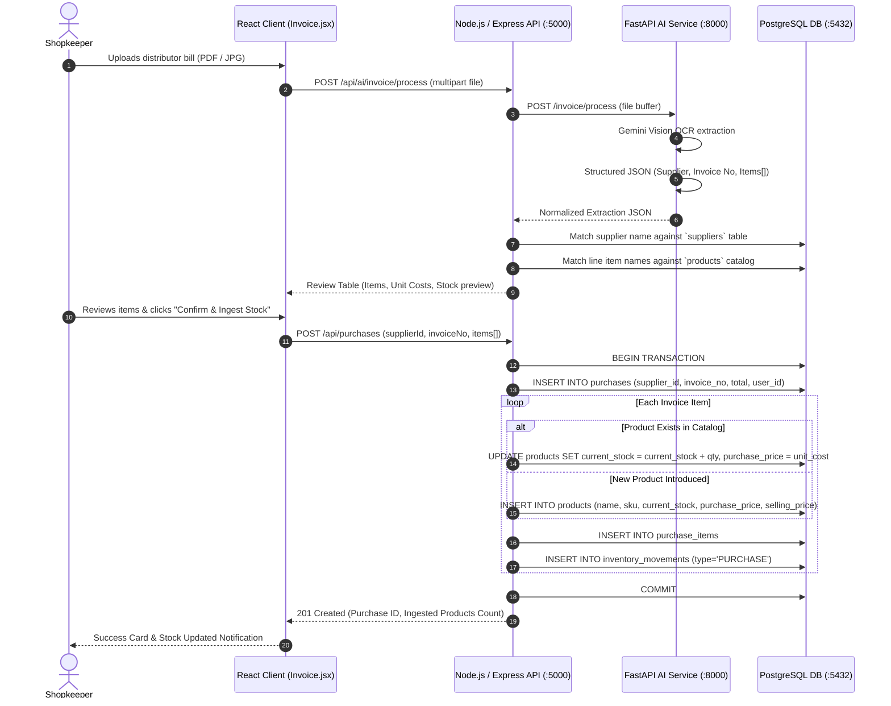

# Feature 02: Supplier Invoice Intelligence (OCR & Automated Stock Ingestion)
## Technical Architecture & Implementation Specification

---

## 1. Problem & Business Objective
Kirana shopkeepers receive dozens of printed paper bills or handwritten invoices from distributors weekly. Manually typing every item into inventory is tedious, error-prone, and often completely neglected, resulting in inaccurate inventory counts and unknown cost prices.

**Supplier Invoice Intelligence** allows the shopkeeper to photograph or upload a distributor bill (PNG, JPG, or PDF). Gemini Vision AI extracts the supplier name, invoice date, and itemized lines (product name, quantity, unit cost price, total). 

**Key Automation**:
1. If the item already exists in the catalog, its stock is automatically replenished (`current_stock = current_stock + qty`) and `purchase_price` is updated.
2. If the item is brand new (e.g. a new soap brand introduced by a distributor), RetailMind automatically inserts it into `products` and populates the stock immediately.

---

## 2. System Architecture & Ingestion Flow



---

## 3. Data Models & Database Schemas

### A. Purchases Header (`purchases`)
```sql
CREATE TABLE purchases (
    id SERIAL PRIMARY KEY,
    user_id INTEGER REFERENCES users(id) ON DELETE CASCADE,
    supplier_id INTEGER REFERENCES suppliers(id) ON DELETE SET NULL,
    invoice_no VARCHAR(100),
    purchase_date DATE DEFAULT CURRENT_DATE,
    total_amount NUMERIC(12,2) NOT NULL,
    created_at TIMESTAMP WITHOUT TIME ZONE DEFAULT CURRENT_TIMESTAMP
);
```

### B. Purchase Line Items (`purchase_items`)
```sql
CREATE TABLE purchase_items (
    id SERIAL PRIMARY KEY,
    purchase_id INTEGER REFERENCES purchases(id) ON DELETE CASCADE,
    product_id INTEGER REFERENCES products(id) ON DELETE RESTRICT,
    quantity INTEGER NOT NULL,
    unit_cost NUMERIC(10,2) NOT NULL,
    total_amount NUMERIC(12,2) NOT NULL
);
```

### C. Suppliers (`suppliers`)
```sql
CREATE TABLE suppliers (
    id SERIAL PRIMARY KEY,
    user_id INTEGER REFERENCES users(id) ON DELETE CASCADE,
    name VARCHAR(255) NOT NULL,
    contact VARCHAR(100),
    created_at TIMESTAMP WITHOUT TIME ZONE DEFAULT CURRENT_TIMESTAMP
);
```

---

## 4. API Specification

### Endpoint 1: Process Invoice File (OCR)
- **Path**: `POST /api/ai/invoice/process`
- **Headers**: `Authorization: Bearer <JWT>`, `Content-Type: multipart/form-data`
- **Body**: `file: <Invoice PDF/JPG/PNG>`
- **Response (`200 OK`)**:
  ```json
  {
    "supplier_name": "Metro Cash & Carry",
    "invoice_no": "INV-2026-891",
    "invoice_date": "2026-09-06",
    "total_amount": 1450.00,
    "confidence": 0.96,
    "items": [
      {
        "product_id": 1,
        "product_name": "Coca Cola 500ml",
        "quantity": 24,
        "unit_cost": 10.00,
        "total_amount": 240.00,
        "is_new_product": false
      },
      {
        "product_id": null,
        "product_name": "Dettol Soap 125g",
        "quantity": 30,
        "unit_cost": 35.00,
        "total_amount": 1050.00,
        "is_new_product": true
      }
    ]
  }
  ```

### Endpoint 2: Confirm Purchase & Stock Ingestion
- **Path**: `POST /api/purchases`
- **Headers**: `Authorization: Bearer <JWT>`, `Content-Type: application/json`
- **Request Body**:
  ```json
  {
    "supplierName": "Metro Cash & Carry",
    "invoiceNo": "INV-2026-891",
    "purchaseDate": "2026-09-06",
    "items": [
      {
        "productId": 1,
        "productName": "Coca Cola 500ml",
        "quantity": 24,
        "unitCost": 10.00
      },
      {
        "productId": "__NEW__",
        "productName": "Dettol Soap 125g",
        "quantity": 30,
        "unitCost": 35.00,
        "sellingPrice": 42.00,
        "isNewProduct": true
      }
    ]
  }
  ```
- **Response (`201 Created`)**:
  ```json
  {
    "message": "Purchase recorded successfully",
    "purchase_id": 12,
    "total_amount": 1290.00,
    "new_products_created": ["Dettol Soap 125g"],
    "stock_updated_count": 2
  }
  ```

---

## 5. Security & Data Integrity
- **Multi-Tenant Protection**: Suppliers and purchase records are isolated by `user_id = req.user.id`.
- **Atomic Execution**: If any line item has invalid negative quantity or NaN price, the transaction rolls back cleanly with detailed error reporting.
- **Stock Auditability**: Every intake creates an `inventory_movements` row with `movement_type = 'PURCHASE'` referencing the purchase order.
