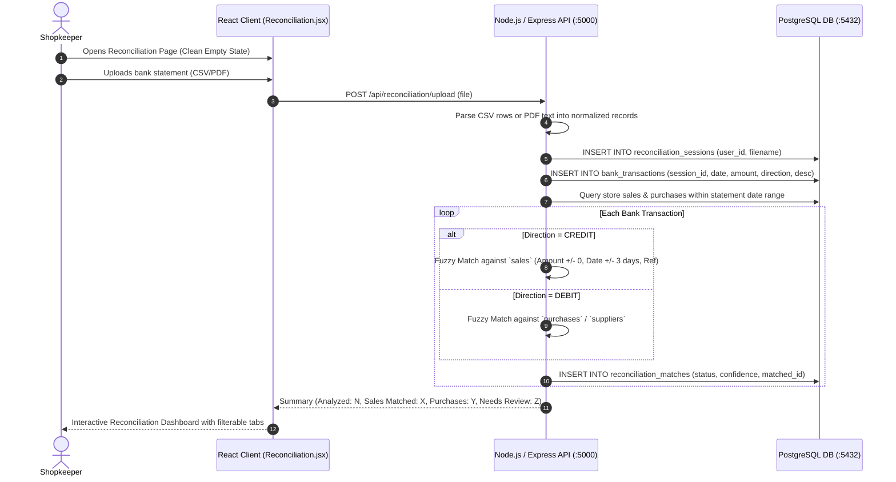

# Feature 03: Payment Reconciliation (Bank Statement vs Store Records)
## Technical Architecture & Implementation Specification

---

## 1. Problem & Business Objective
Retailers accept hundreds of digital UPI payments, card swipes, and direct bank transfers daily, while paying suppliers via NEFT/IMPS. Reconciling whether every recorded store sale was actually credited to the bank—or if duplicate charges, missing credits, or unauthorized debits occurred—is practically impossible to do manually on a weekly basis.

**Payment Reconciliation** solves this by ingesting standard bank statements (CSV or PDF), parsing every debit and credit, comparing them against the store's sales and purchase records, and applying a multi-factor matching engine:
- **Credits** matched against customer sales (Amount, date window, customer name / reference).
- **Debits** matched against supplier purchases.
- **Unmatched Transactions** categorized for manual review (Personal expenses, bank charges, unknown receipts).

---

## 2. System Architecture & Matching Engine Flow



---

## 3. Data Models & Database Schemas

### A. Reconciliation Sessions (`reconciliation_sessions`)
```sql
CREATE TABLE reconciliation_sessions (
    id SERIAL PRIMARY KEY,
    user_id INTEGER REFERENCES users(id) ON DELETE CASCADE,
    filename VARCHAR(255) NOT NULL,
    total_transactions INTEGER DEFAULT 0,
    matched_count INTEGER DEFAULT 0,
    unmatched_count INTEGER DEFAULT 0,
    created_at TIMESTAMP WITHOUT TIME ZONE DEFAULT CURRENT_TIMESTAMP
);
```

### B. Normalized Bank Transactions (`bank_transactions`)
```sql
CREATE TABLE bank_transactions (
    id SERIAL PRIMARY KEY,
    session_id INTEGER REFERENCES reconciliation_sessions(id) ON DELETE CASCADE,
    transaction_date DATE NOT NULL,
    description TEXT,
    amount NUMERIC(12,2) NOT NULL,
    direction VARCHAR(10) NOT NULL, -- 'CREDIT' or 'DEBIT'
    reference_no VARCHAR(100),
    status VARCHAR(30) DEFAULT 'UNMATCHED', -- 'MATCHED', 'REVIEW_REQUIRED', 'UNMATCHED'
    created_at TIMESTAMP WITHOUT TIME ZONE DEFAULT CURRENT_TIMESTAMP
);
```

### C. Reconciliation Matches (`reconciliation_matches`)
```sql
CREATE TABLE reconciliation_matches (
    id SERIAL PRIMARY KEY,
    user_id INTEGER REFERENCES users(id) ON DELETE CASCADE,
    bank_transaction_id INTEGER REFERENCES bank_transactions(id) ON DELETE CASCADE,
    sale_id INTEGER REFERENCES sales(id) ON DELETE SET NULL,
    purchase_id INTEGER REFERENCES purchases(id) ON DELETE SET NULL,
    direction VARCHAR(10) NOT NULL,
    confidence NUMERIC(5,2) NOT NULL,
    status VARCHAR(30) NOT NULL,
    created_at TIMESTAMP WITHOUT TIME ZONE DEFAULT CURRENT_TIMESTAMP
);
```

---

## 4. Matching Algorithm Scoring Weights

The matching engine scores candidates from **0 to 100%**:

| Criterion | Weight | Logic |
|---|---|---|
| **Exact Amount Match** | **50%** | Absolute difference = 0 gives 50 points; partial match scaled. |
| **Date Proximity** | **30%** | Same calendar day = 30 pts; +/- 1 day = 25 pts; +/- 3 days = 15 pts. |
| **Reference / Description** | **20%** | Customer name, UTR number, or UPI ID match found in statement narrative. |

- **Confidence $\ge 80\%$**: Marked as `MATCHED`.
- **Confidence $50\% - 79\%$**: Marked as `REVIEW_REQUIRED` (presented to shopkeeper with top candidate).
- **Confidence $< 50\%$**: Marked as `UNMATCHED` (unidentified cash flow).

---

## 5. API Specification

### Endpoint 1: Upload Bank Statement
- **Path**: `POST /api/reconciliation/upload`
- **Headers**: `Authorization: Bearer <JWT>`, `Content-Type: multipart/form-data`
- **Body**: `file: <CSV or PDF>`
- **Response (`200 OK`)**:
  ```json
  {
    "message": "Bank statement uploaded and analyzed successfully",
    "session_id": 8,
    "summary": {
      "transactions_analyzed": 27,
      "sales_matched": 14,
      "purchases_matched": 5,
      "needs_review": 8,
      "match_rate": "70%"
    },
    "matched_sales": [...],
    "matched_purchases": [...],
    "unidentified": [...]
  }
  ```

### Endpoint 2: Get Reconciliation Summary & Sessions
- **Path**: `GET /api/reconciliation/summary`
- **Headers**: `Authorization: Bearer <JWT>`
- **Response (`200 OK`)**: Returns financial overview metrics (sales, purchases, estimated profit) scoped strictly to `user_id`.

---

## 6. Critical Empty State & Session Isolation
- **Empty State Guarantee**: When opening `/reconciliation` without uploading a statement, the page displays a clean file upload hero without populating historical transactions as if they belong to a newly uploaded statement.
- **Multi-Tenant Protection**: All matching queries (`WHERE user_id = $1`) guarantee that User A never sees bank statements or matches belonging to User B.
