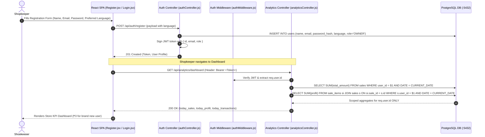
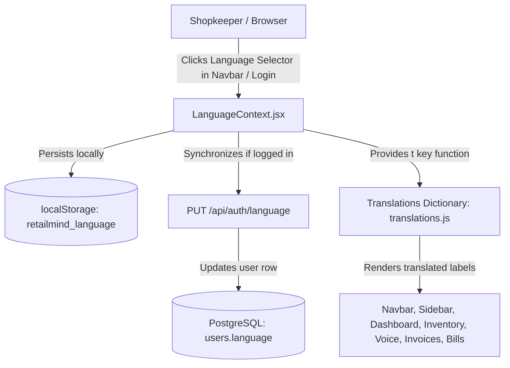

# Feature 05: Store Analytics, Multi-Tenancy & Authentication
## Technical Architecture & Implementation Specification

---

## 1. Problem & Business Objective
RetailMind is a cloud-based retail platform serving multiple independent shopkeepers.
Two non-negotiable requirements govern this architecture:
1. **Strict Multi-Tenancy Data Isolation**: A shopkeeper logging in must **only** see their own sales, profits, purchases, and inventory metrics. Under no circumstance should a newly registered user see sales or profits generated by another shopkeeper.
2. **Frictionless Onboarding with Preferred Language**: Shopkeepers across India speak and operate in different languages (English, Hindi, Marathi, Gujarati, Bengali, Tamil, Telugu, etc.). The registration experience must allow them to select their preferred language right away.

---

## 2. Multi-Tenant Architecture & Auth Flow



---

## 3. Data Models & Database Schemas

### Users Table (`users`)
```sql
CREATE TABLE users (
    id SERIAL PRIMARY KEY,
    name VARCHAR(255) NOT NULL,
    email VARCHAR(255) UNIQUE NOT NULL,
    password_hash TEXT NOT NULL,
    role VARCHAR(50) DEFAULT 'OWNER',
    language VARCHAR(50) DEFAULT 'English',
    voice_language VARCHAR(50) DEFAULT 'English',
    store_name VARCHAR(255),
    business_type VARCHAR(100) DEFAULT 'Grocery / Kirana',
    location VARCHAR(255),
    currency VARCHAR(10) DEFAULT 'INR',
    ai_preference VARCHAR(50) DEFAULT 'Standard',
    created_at TIMESTAMP WITHOUT TIME ZONE DEFAULT CURRENT_TIMESTAMP
);
```

---

## 4. Multi-Tenant Analytics Queries

To guarantee complete data isolation between shopkeepers, every query in `analyticsController.js` is strictly parameterized by `req.user.id`:

### A. Today's Total Sales & Transactions
```sql
SELECT
  COALESCE(SUM(total_amount), 0) AS total_sales,
  COUNT(*) AS total_transactions
FROM sales
WHERE user_id = $1
  AND (DATE(sale_date) = CURRENT_DATE OR DATE(created_at) = CURRENT_DATE);
```

### B. Today's Profit Isolation
```sql
SELECT
  COALESCE(SUM(si.profit), 0) AS total_profit
FROM sale_items si
JOIN sales s ON si.sale_id = s.id
WHERE s.user_id = $1
  AND (DATE(s.sale_date) = CURRENT_DATE OR DATE(s.created_at) = CURRENT_DATE);
```

### C. Profit Breakdown by Product (Subquery Scoped)
```sql
SELECT
  p.id,
  p.name,
  COALESCE(SUM(si.quantity), 0) AS units_sold,
  COALESCE(SUM(si.total_amount), 0) AS revenue,
  COALESCE(SUM(si.quantity * si.cost_price), 0) AS cost,
  COALESCE(SUM(si.profit), 0) AS profit
FROM products p
LEFT JOIN (
  SELECT si.product_id, si.quantity, si.total_amount, si.cost_price, si.profit
  FROM sale_items si
  JOIN sales s ON si.sale_id = s.id
  WHERE s.user_id = $1
) si ON p.id = si.product_id
GROUP BY p.id, p.name
ORDER BY profit DESC;
```

---

## 5. Website Localization Architecture (English, Hindi, Marathi, Gujarati)

RetailMind AI implements a complete 4-language internationalization (i18n) framework:
- **English (`en`)**: International commercial standard.
- **Hindi (`hi` - हिन्दी)**: Devanagari script for North and Central India retail.
- **Marathi (`mr` - मराठी)**: Devanagari script for Maharashtra and West India retail.
- **Gujarati (`gu` - ગુજરાતી)**: Gujarati script for Gujarat mercantile and wholesale trade.



### A. Translation Dictionary Module (`frontend/src/i18n/translations.js`)
* Provides structured dictionary keys for `nav.*`, `common.*`, `dashboard.*`, `voice.*`, `invoice.*`, `inventory.*`, `recon.*`, `auth.*`, and `bill.*`.
* Evaluates translations in current language; automatically falls back to English (`en`) if a specific localized key is missing.

### B. Language Context (`frontend/src/context/LanguageContext.jsx`)
* **State Initialization**: Reads from `localStorage.getItem("retailmind_language")`, falls back to authenticated user profile `user.language`, or defaults to `'en'`.
* **Normalization**: Normalizes language strings (e.g. `'Hindi'` $\rightarrow$ `'hi'`, `'Marathi'` $\rightarrow$ `'mr'`, `'Gujarati'` $\rightarrow$ `'gu'`).
* **Global Sync**: Automatically fires `updateUserLanguage(code)` to backend when the shopkeeper toggles languages.

### C. Backend API Specification: Language Preference Update
- **Path**: `PUT /api/auth/language`
- **Headers**: `Authorization: Bearer <JWT_TOKEN>`
- **Request Body**:
  ```json
  {
    "language": "mr"
  }
  ```
- **Response (`200 OK`)**:
  ```json
  {
    "message": "Language updated successfully",
    "language": "mr"
  }
  ```

---

## 6. API Specification

### Endpoint 1: Register New Store Owner
- **Path**: `POST /api/auth/register`
- **Request Body**:
  ```json
  {
    "name": "Ramesh Gupta",
    "email": "ramesh@guptakirana.com",
    "password": "SecretPassword123!",
    "phone": "+91 98765 43210",
    "store_name": "Gupta Super Store",
    "business_type": "Grocery / Kirana",
    "location": "Mumbai, Maharashtra",
    "currency": "INR",
    "language": "hi",
    "voice_language": "hi",
    "ai_preference": "Standard"
  }
  ```
- **Response (`201 Created`)**: Returns signed JWT token and user profile.

### Endpoint 2: Store Owner Login
- **Path**: `POST /api/auth/login`
- **Request Body**: `{ "email": "...", "password": "..." }`
- **Response (`200 OK`)**: `{ "token": "...", "user": { "id": 1, "language": "hi", ... } }`

### Endpoint 3: Update User Language
- **Path**: `PUT /api/auth/language`
- **Headers**: `Authorization: Bearer <JWT>`
- **Request Body**: `{ "language": "gu" }`
- **Response (`200 OK`)**: `{ "message": "Language updated successfully", "language": "gu" }`

### Endpoint 4: Dashboard Real-time KPIs
- **Path**: `GET /api/analytics/dashboard`
- **Headers**: `Authorization: Bearer <JWT>`
- **Response (`200 OK`)**:
  ```json
  {
    "today_sales": 0,
    "today_transactions": 0,
    "today_profit": 0,
    "today_expenses": 0,
    "low_stock_products": 1
  }
  ```

---

## 7. Security & Isolation Guarantees
- **Passwords**: Salted and hashed using `bcrypt` (10 rounds). Plaintext passwords are never stored or logged.
- **JWT**: Tokens expire after 24 hours and require server secret signature.
- **Data Privacy**: Users cannot read, update, or delete sales, purchases, or customer records belonging to another `user_id`.
- **Localization Independence**: Each shopkeeper's language preference is stored in their personal database row and browser storage; one retailer changing their language never affects any other retailer.

---

## 8. Capstone Viva Q&A (Store Analytics, Auth & Localization)

### Q1: How does RetailMind prevent data leakage between different shopkeepers?
**Answer**: Multi-tenancy is enforced through the JWT authentication middleware (`authMiddleware.js`). When a shopkeeper logs in, their unique user ID (`req.user.id`) is signed into the JWT token. On every protected request, the server extracts `req.user.id` and strictly attaches it to SQL queries (`WHERE user_id = $1`). Brand new users start with completely empty, zero-valued KPI states (`₹0 Sales`, `₹0 Profit`).

### Q2: Which 4 languages are supported, and how are language preferences saved?
**Answer**: RetailMind supports **English (`en`)**, **Hindi (`hi` - हिन्दी)**, **Marathi (`mr` - मराठी)**, and **Gujarati (`gu` - ગુજરાતી)**. The preference is chosen at registration, saved in the PostgreSQL `users.language` column, cached in the browser's `localStorage` under `retailmind_language`, and dynamically updated across sessions via `PUT /api/auth/language`.

### Q3: Why did we build a custom `LanguageContext` instead of a heavy third-party i18n package?
**Answer**: A custom `LanguageContext` with `translations.js` gives us zero external dependency overhead, eliminates async loading flickers, and provides an immediate English fallback (`translations.en[key]`) if any regional string is not yet defined. It also allows direct programmatic switching connected with backend user profile persistence.

### Q4: What happens if a user enters "Hindi" or "मराठी" during registration instead of standard ISO codes?
**Answer**: The backend implements `normalizeLanguageCode()` in `authController.js` which detects prefixes like `"hi"`, `"mar"`, `"mr"`, `"gu"`, `"guj"`, or `"en"` and normalizes them into standard ISO-639-1 two-letter codes (`hi`, `mr`, `gu`, `en`) before writing to PostgreSQL.

### Q5: How is password security implemented for store owners?
**Answer**: Passwords are encrypted before database insertion using `bcrypt` with 10 salt rounds in `authController.js`. During login, `bcrypt.compare()` validates the incoming password against the stored cryptographic hash without ever decrypting or exposing the plaintext password.
